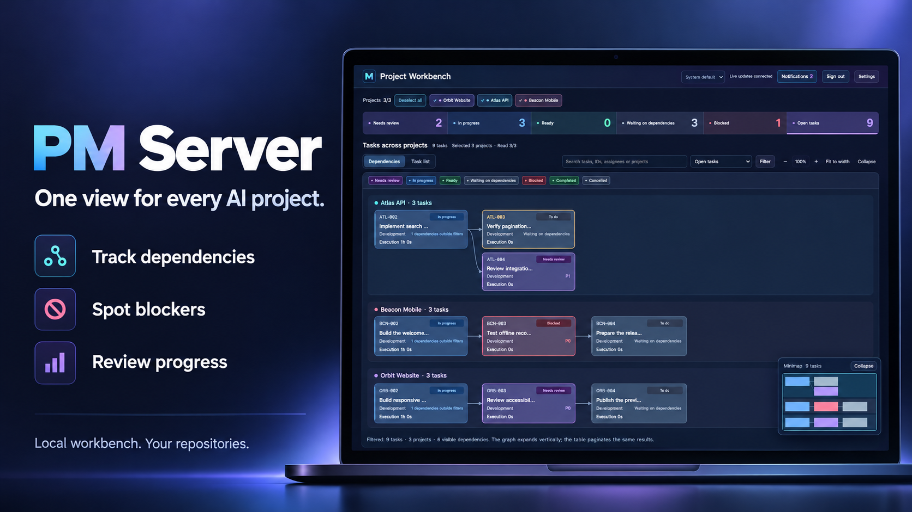

# PM Server

[English](README.md) · [简体中文](README.zh-CN.md)

**A local workbench for AI coding projects, with proactive task monitoring and a fallback for missed handoffs.**



When work spreads across projects and AI sessions, PM Server brings progress into one place and keeps checking execution in the background. Surface work that needs follow-up when execution becomes inactive, a result awaits handoff or runtime observations are missing. Task records stay in their own repositories.

## What you get

- **A view across projects.** Explore task dependencies and activity, then open the underlying details and evidence.
- **Proactive monitoring and follow-up.** Periodically check active tasks for inactive execution and missing or stale runtime observations.
- **A fallback for handoffs and monitoring.** Remind the manager to check results and coordinate the next step. A supervisor detects monitor worker exits or timeouts and restarts the worker within a retry limit.
- **Control of your workspace.** Automatically connect projects, blacklist unwanted connections, share read-only views, and keep project files on your machine.

[See the actual workbench →](docs/images/workbench.png) · Fictional English demo projects.

## How tasks get followed through

With the service running and runtime observation connected, background checks inspect active tasks in registered projects independently of the workbench page. When an execution session becomes inactive, the monitor sends a reconciliation reminder to the registered project manager, providing a fallback for a missed completion callback or handoff. Missing or stale observations produce evidence warnings for the manager to investigate.

Message delivery requires an [explicitly configured notification backend](docs/usage.md#configure-reminders). Reminders support deduplication and timed pauses; the manager checks the facts before changing task status, reassigning work or accepting delivery. Failed project checks are reported separately, and monitor workers have bounded restart recovery. If the top-level service exits, it needs to be started again.

## Get started

The awaiting-confirmation reminders described in the [usage guide](docs/usage.md#awaiting-confirmation-follow-up) are an Unreleased GitHub source feature. The published npm `0.1.0-rc.16` package does not include them.

Requires Node.js 22+. Install the preview release:

```sh
npm install -g pm-server@next
pm-server setup
pm-server project request --repo /absolute/path/to/project
pm-server open
```

`pm-server setup` is the primary onboarding entry. Its terminal menu separates basic checks, selected-host configuration and deferred runtime diagnostics and offers hook installation, service startup, optional Codex Hook review, project connection and notification testing. Exit and rerun to continue. Hook installation merges user configuration with a backup. Review and trust the hooks through Codex CLI `/hooks`, then run a session with a tool call. After Codex integration, service startup prepares the default notification channel automatically. The background service checks notifications after the first manager is registered. Success needs no action; only failures are shown. Custom backends and explicit disabling take precedence.

Valid projects join automatically. Remove a project in Settings to blacklist it and prevent automatic rejoining; restore it explicitly when needed. The workbench defaults to `http://127.0.0.1:9999/`; use `pm-server status` for the actual address and state directory. The password is in that directory’s `password.txt`. Stop it with `pm-server service stop`.

The workbench’s **Settings → Setup guide** separates global source checks from required configuration for selected hosts. Codex checks the Hook return entry/binding and notification send configuration; loading, events, receipt and manager alignment are deferred runtime diagnostics. Login is not an onboarding check. Host selection changes only the check scope; it does not install or stop integrations. Configuration does not prove notification receipt or returned results. See [setup guidance and risks](docs/usage.md#setup-guide-and-reminders).

## Add the project manager

Use [PM Skill](https://github.com/gordonzhy/pm-skill) to help your assistant plan tasks, coordinate execution and review evidence. PM Server provides the workbench and background observation; PM Skill provides the working method.

## Learn more

[Setup and usage](docs/usage.md) · [Platform connections](docs/usage.md#connect-a-platform) · [Development](docs/usage.md#development-and-release) · [Continuous delivery](docs/continuous-delivery.md) · [Changelog](CHANGELOG.md)

Codex, Claude Code and DSH can use the common event interface; native integration support varies. See the setup guide for current platform and operating-system coverage.

[MIT License](LICENSE)

See [GitHub operations](docs/github-operations.md) for hourly issue acknowledgement, the maintainer queue and Actions failure tracking.
