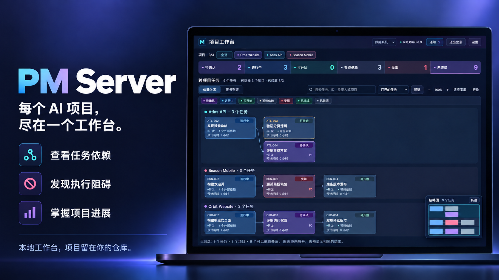

# PM Server

[English](README.md) · [简体中文](README.zh-CN.md)

**为 AI 编程项目提供本地统一工作台，主动监测任务，为遗漏的交接兜底。**



当工作分散在多个项目和 AI 会话里，PM Server 把进展汇聚到一起，并在后台持续检查任务运行情况。执行会话已停止活动、成果还没交接，或运行观察缺失时，让需要跟进的工作浮现出来。任务记录仍留在各自仓库。

## 你会得到什么

- **看清多个项目。** 查看任务依赖和活动，打开详情，追溯交付证据。
- **主动监测，提醒跟进。** 定期检查进行中任务的执行状态，为非活动执行、观察缺失或过期提供提醒。
- **交接与监测都有兜底。** 提醒经理核对最新成果、衔接下一步；监督进程检测监测工作进程退出或超时，并在限定次数内重启。
- **掌握自己的工作区。** 项目自动连接、黑名单屏蔽、分享只读视图，让项目文件留在本机。

[查看真实工作台截图 →](docs/images/workbench.png) · 全英文虚构示例项目。

## 任务怎样得到持续跟进

服务启动并接入运行观察后，后台独立于工作台页面检查已登记项目的进行中任务。执行会话转为非活动时，监测器向登记的项目经理发出恢复核对提醒，为遗漏的完成回调或交接提供兜底；观察缺失或过期时，发出缺证据警告，由经理核对实际情况。

消息投递需要[显式配置通知后端](docs/usage.zh-CN.md#配置提醒)。提醒支持去重和有期限暂停；任务状态、是否重派及交付验收仍由经理核对后决定。单个项目检查异常独立报告，监测工作进程故障可有界重启；顶层服务退出后需要重新启动服务。

## 快速开始

[使用指南](docs/usage.zh-CN.md#待确认任务跟进)中的待确认提醒属于 GitHub Unreleased 源码特性，已发布的 npm `0.1.0-rc.16` 包不包含此功能。

需要 Node.js 22+。安装预发布版本：

```sh
npm install -g pm-server@next
pm-server setup
pm-server project request --repo /absolute/path/to/project
pm-server open
```

`pm-server setup` 是接入主入口：终端菜单逐项检查并提供 Hook 安装、服务启动、可选 Codex Hook 审查、项目连接和通知测试，可退出后再次运行继续。安装 Hook 会合并用户级配置并备份；在 Codex CLI 输入 `/hooks` 审查并信任后，运行一次含工具调用的会话。Codex接入后启动服务会自动准备默认通知通道；首次登记经理后后台自动检查通知通道，成功无需操作，失败才提醒。已有自定义后端和显式停用设置优先。

有效项目会自动加入工作台，无需确认。在设置中移除即加入黑名单，避免再次自动加入；需要时可手动恢复。工作台默认地址为 `http://127.0.0.1:9999/`；运行 `pm-server status` 查看实际地址与状态目录，密码保存在该目录的 `password.txt`。使用 `pm-server service stop` 停止服务。

工作台的**设置 → 接入引导**区分全局来源检查与已选宿主必要配置。Codex只检查Hook回传入口/绑定和通知发送配置；加载、事件、收发回执与经理对齐延迟到运行时验证，登录不作引导检查。宿主选择只改变检查范围，不安装或启停接入。已配置不证明通知已收到或结果已回传。详见[配置与运行验证说明](docs/usage.zh-CN.md#工作台基础检查与可选诊断)。

## 配上项目经理

搭配 [PM Skill](https://github.com/gordonzhy/pm-skill)，让助手规划任务、协调执行、检查证据。PM Server 提供工作台与后台观察，PM Skill 提供推进项目的方法。

## 进一步了解

[安装与使用](docs/usage.zh-CN.md) · [平台接入](docs/usage.zh-CN.md#平台接入) · [开发](docs/usage.zh-CN.md#开发验证与发布) · [自动发布](docs/continuous-delivery.zh-CN.md) · [更新记录](CHANGELOG.zh-CN.md)

Codex、Claude Code、DSH 可使用统一事件接口，原生接入支持程度不同；当前平台及操作系统范围见使用指南。

[MIT License](LICENSE)
